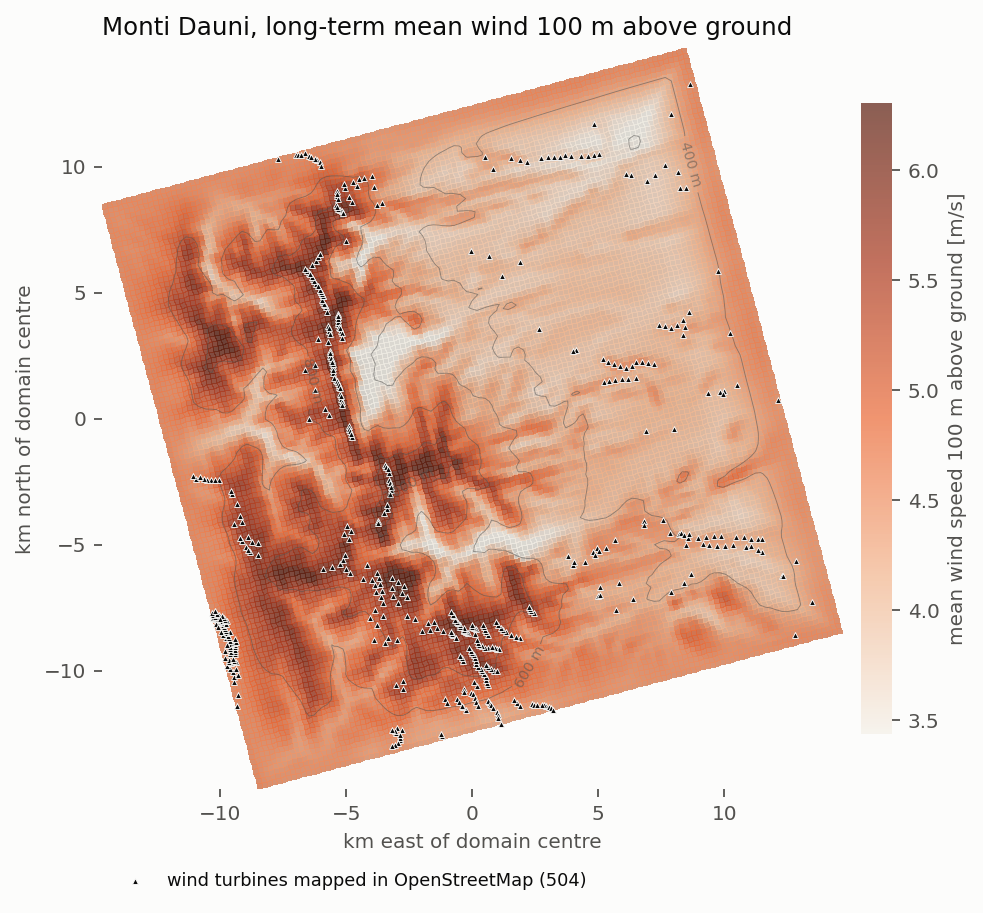
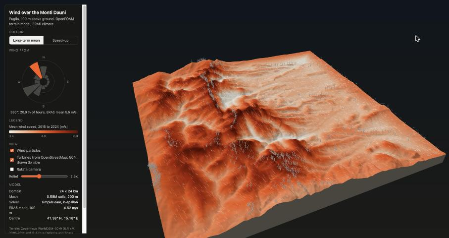
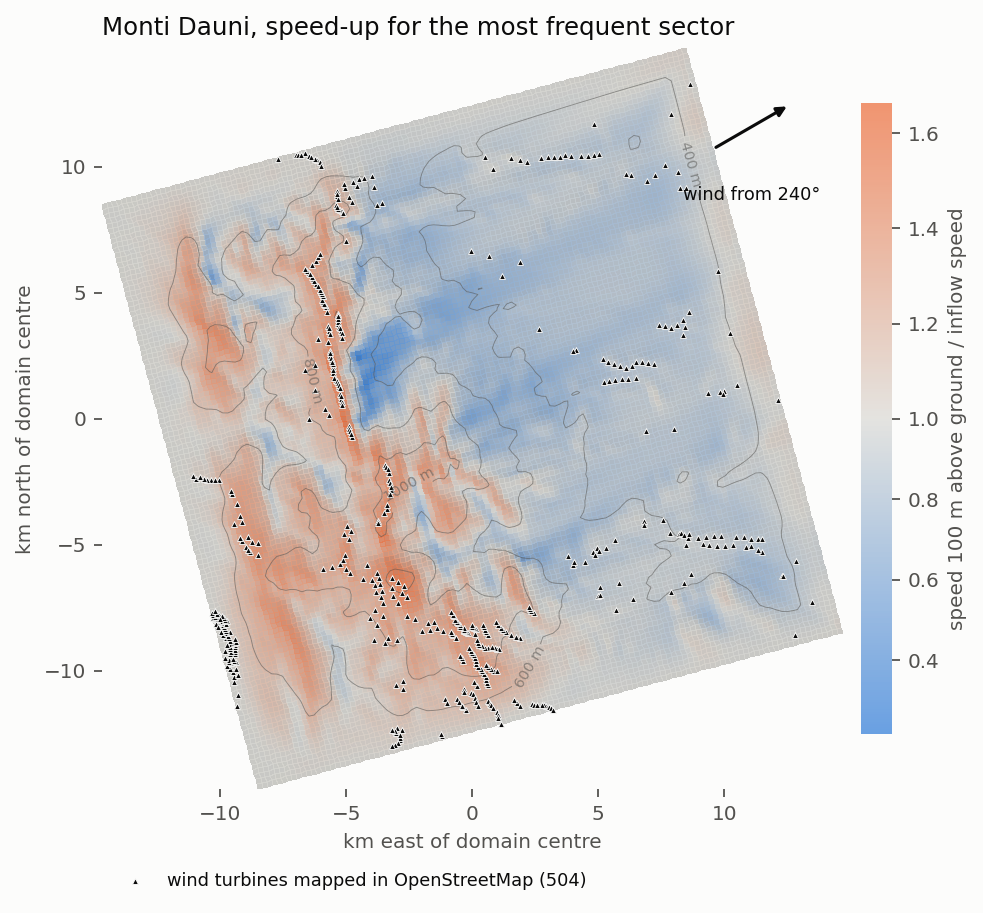
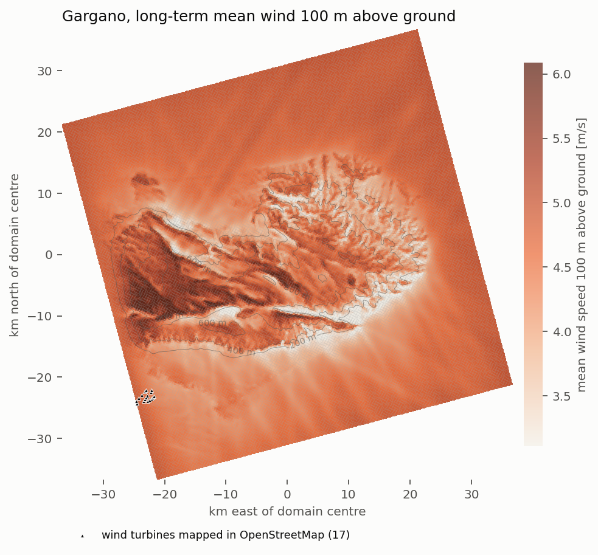

# puglia-wind

Wind flow over two sites in northern Puglia, the Monti Dauni and the Gargano, with OpenFOAM built from source. A 24 km square of real terrain, twelve wind directions, and ten years of ERA5 wind combined into a long-term map of mean wind 100 m above the ground, which is hub height for most of the turbines built there.



There is also a 3D viewer for both sites in `docs/`, live at [fratepietro.com/puglia-wind](https://www.fratepietro.com/puglia-wind/) (three.js, no build step): the terrain coloured by mean wind or by the speed-up for any of the twelve directions, particles following the solved flow 100 m above ground, and the turbines with rotors turned into the selected wind. Serve it with `python3 -m http.server -d docs`.



The triangles are the 504 wind turbines mapped in OpenStreetMap inside the domain. They are only drawn on the map; the model doesn't use them.

## Results so far (200 m mesh, 576k cells)

| | |
|---|---|
| ERA5 mean at 100 m, 2015 to 2024 | 4.62 m/s (Weibull k 1.73, A 5.19) |
| Most frequent sectors | 240° (21 %), 330° (20 %), 0° (14 %), 210° (13 %) |
| Modelled mean at 100 m, domain | 2.7 to 6.7 m/s |
| Modelled mean at the turbines (264 outside the edge ring) | 5.47 m/s, against 4.55 m/s for the domain |
| Median turbine, percentile of modelled wind | 94 |
| Median turbine, percentile among cells of the same elevation (±25 m) | 80 |

Most of the placement is explained by height alone: the median turbine is also at percentile 93 of elevation. The last row is the part height doesn't explain. At the same elevation the turbines still sit on the windier cells, the exposed crests rather than sheltered ground of the same height.



For the most frequent direction the flow speeds up by as much as 1.7 times over the crests and drops below half the inflow speed in the lee valleys.

## Second site: the Gargano

The Gargano is the promontory north of the Monti Dauni, with the Adriatic on three sides. Same method on a 60 km square at 250 m (2.3M cells), with one change: the ground roughness follows a land/sea mask from the ISTAT coastline, z0 = 0.1 m on land and 0.0002 m on the sea (53 % of the ground faces are land). ERA5 there gives 5.05 m/s at 100 m, mostly from 330° (21 %) and 300° (16 %). All twelve directions converged, in 313 to 601 iterations.



The windiest ground is the western ridges facing the north-westerlies; the inland valleys and the sea in the lee of the south coast are much calmer, and the wind slows where it crosses from the sea onto land. The only 17 turbines OpenStreetMap has in this square stand on the Tavoliere plain in the south-west corner, none on the promontory itself, most of which is national park.

## HPC stack

Everything that is timed is built from source with [Spack](https://spack.io) 1.2, one environment per toolchain (`spack/`). The prebuilt OpenCFD container in `docker/` is only for developing the case.

| Toolchain | Compilers | BLAS / LAPACK | MPI | Built |
|---|---|---|---|---|
| `gnu` | GCC 13.3 | OpenBLAS 0.3.33 | Open MPI 5.0.10 | OpenFOAM 2506, STREAM 5.10, HPL 2.3 |
| `zenss` | AOCC 5.2 (AMD Zen Software Studio) | AOCL-BLIS 5.3, AOCL-libFLAME 5.3 | Open MPI 5.0.10 | OpenFOAM 2506, STREAM 5.10, HPL 2.3 |
| `oneapi` | Intel oneAPI 2026.0 (icx, ifx) | oneMKL 2026.0 | Intel MPI 2021.18 | STREAM 5.10, HPL 2.3 |

Why these benchmarks: `simpleFoam` on a structured hex mesh does little arithmetic per byte it moves, so it is limited by memory bandwidth, not FLOPs. STREAM triad is the number that bounds the solver and tells you where its scaling over cores will flatten. HPL is there to check the compiler, BLAS and MPI stack end to end; its residual check catches a broken build before the CFD numbers do.

Build and run notes:

- In Spack 1.x, `%aocc` binds AOCC to at least one language per package and lets the solver pick GCC for the rest (and for dependencies). The `toolchains:` block in `spack/zenss.yaml` pins C, C++ and Fortran to AOCC, so the whole chain, Open MPI and BLIS included, is AOCC.
- AOCC needs `+license-agreed` (AMD's EULA) before Spack will install it, and `%aocc` only resolves once the compiler is installed.
- OpenFOAM pulls in ADIOS2, whose default XRootD backend fails to configure: its HTTP plugin needs curl, which the XRootD package doesn't declare. `adios2 ~xrootd ~libcatalyst` in the environments avoids it.
- The first OpenFOAM install "succeeded" in five minutes with no solvers in it. Spack 1.x hands builds a make jobserver over a named pipe (`--jobserver-auth=fifo:...`), which GNU make before 4.4 can't read; Ubuntu 24.04 ships 4.3, and the OpenFOAM package uses whatever make is on `PATH`. Every `wmake` call stopped, `Allwmake` printed "ignoring possible compilation errors" and exited 0. `scripts/spack_install.sh` builds gmake 4.4 first and fails if `simpleFoam` is missing afterwards.
- `scripts/node_baseline.sh` runs STREAM (one thread per core, `OMP_PROC_BIND=spread`, `OMP_PLACES=cores`) and HPL (one rank per core, P x Q grid close to square) and records the toolchain, every package hash and the CPU in `results/*.json`.
- `scripts/bench_solver.sh` runs `simpleFoam` for a fixed number of iterations with whichever OpenFOAM build is loaded, records wall time and seconds per iteration, and compares the 100 m wind field with a reference run, so a fast but wrong build doesn't count.
- Parallel runs use scotch domain decomposition (`decomposePar`) and one MPI rank per core.

Functional check so far (containers on a laptop, x86 under emulation, so the timings are not meaningful and are not reported):

| Toolchain | Platform | STREAM | HPL residual |
|---|---|---|---|
| `gnu` | arm64, native | runs | passed |

OpenFOAM 2506 from source with GCC 13.3 (`spack/gnu.yaml`, arm64) builds in about an hour on 4 jobs and reproduces the container build on the Monti Dauni case: after 200 iterations of wind from 240°, the 100 m wind fields differ by 0.00055 m/s RMS and at most 0.018 m/s, about 0.1 % of the peak speed (`results/solver_*.json`). The AOCC 5.2 build (`spack/zenss.yaml`, x86-64, Open MPI built with AOCC too) took 3.4 hours under emulation and passes the same check: 0.0021 m/s RMS and at most 0.067 m/s (0.4 % of the 16.6 m/s peak), with 99 % of cells within 0.006 m/s. The larger maximum is a different compiler, instruction set and floating-point order on a run stopped at 200 iterations, before full convergence.
| `zenss` | x86-64, emulated | runs | passed |
| `oneapi` | x86-64, emulated | runs | failed, also with `MKL_ENABLE_INSTRUCTIONS=SSE4_2`; to recheck on real x86 |

Next on an AMD EPYC node: STREAM and HPL per toolchain, OpenFOAM GCC against AOCC with `-march=znver4` against generic x86-64-v3, strong scaling of `simpleFoam` from 1 rank to a full socket with scotch against hierarchical decomposition, and the time and cost of a full twelve-direction sweep.

## Method

- Terrain: Copernicus DEM GLO-30, projected to UTM 33N and cut around 41.38 N, 15.18 E (`scripts/terrain.py`).
- Mesh: one structured block from `blockMesh`, with each point column moved onto the terrain and graded towards the ground (first cell 5 to 7 m). A 3 km ring at the edges blends to flat ground, so the inflow sees level terrain (`scripts/mesh.py`).
- Solver: `simpleFoam`, k-epsilon, Richards and Hoxey inflow profiles (`atmBoundaryLayerInlet*`), rough wall with z0 = 0.1 m. All four sides carry the same inlet/outlet condition, so one mesh serves every direction and only `flowDir` changes (`case/template`).
- Climate: hourly 100 m wind from ERA5 through the Open-Meteo archive API, binned into twelve 30° sectors with a Weibull fit each (`scripts/wind_climate.py`). Each sector's speed-up scales its Weibull distribution; the sectors are then weighted by frequency (`scripts/wind_map.py`).

Two things that cost time:

- With the mesh aligned to UTM, the four directions parallel to a side (0, 90, 180, 270°) never converged. The flux through the parallel sides is close to zero, the inlet/outlet switch flips every iteration, and the cross-stream velocity residual stalls at about 1e-2. Rotating the mesh 15° against UTM fixes it: all twelve directions now converge in 225 to 275 iterations, except 240°, which levels off at about 1e-5 (just above the 1e-5 target for Uz and k) and runs to the 1500-iteration cap.
- The ABL inlet conditions inherit from `inletOutlet` and need an explicit `value` entry, or the case stops at time 0.

## Limits

- 200 m cells are too coarse for single turbine positions; the 50 m mesh (about 14M cells) is the target.
- Neutral stability only, no Coriolis, uniform roughness. Forest and land use (CORINE) would change z0 locally.
- ERA5 is used as the undisturbed inflow, but its 31 km grid already sees a smoothed version of these hills.
- OSM turbine coverage is volunteered and incomplete.

## Run it

```bash
docker build -t puglia-wind:dev docker              # OpenFOAM v2506 + GDAL
scripts/fetch_dem.sh
python3 scripts/terrain.py
python3 scripts/wind_climate.py
mkdir -p case/runs/mesh-200/constant && cp -r case/template/system case/runs/mesh-200/
python3 scripts/mesh.py case/runs/mesh-200 --dx 200 --nz 40
NP=4 scripts/run_sweep.sh case/runs/mesh-200
python3 scripts/wind_map.py case/runs/mesh-200
python3 scripts/turbines.py --mesh case/runs/mesh-200/mesh.json
python3 scripts/turbine_check.py case/runs/mesh-200-climate.npz
python3 report/plot_map.py case/runs/mesh-200-climate.npz --field mean -o report/figures/mean_wind.png
python3 report/export_web.py case/runs/mesh-200      # data for docs/
```

The Python and OpenFOAM steps run inside the container. On a cluster node, build the toolchains with Spack instead:

```bash
scripts/spack_install.sh zenss                     # creates and installs the pw-zenss environment
scripts/node_baseline.sh pw-zenss zenss
spack env activate pw-zenss && spack load openfoam
NP=64 scripts/bench_solver.sh case/runs/mesh-200 spack-aocc-znver4
```

## To do

- [x] Spack environments for GCC, AOCC/AOCL and oneAPI/MKL
- [x] STREAM and HPL built with all three; HPL residual passes with GCC/OpenBLAS and AOCC/BLIS
- [x] OpenFOAM 2506 from source with GCC, results checked against the container build
- [x] OpenFOAM 2506 from source with AOCC, same check
- [ ] STREAM, HPL and `simpleFoam` timings on an EPYC node, with `-march=znver4` against x86-64-v3
- [ ] Strong scaling of `simpleFoam` over cores, scotch against hierarchical decomposition
- [ ] 50 m mesh and the time and cost of a full twelve-direction sweep
- [ ] Roughness from CORINE land cover
- [ ] Check against a measured series

## Data

- Terrain: produced using Copernicus WorldDEM-30 © DLR e.V. 2010-2014 and © Airbus Defence and Space GmbH 2014-2018 provided under COPERNICUS by the European Union and ESA; all rights reserved.
- Wind: contains modified Copernicus Climate Change Service information (ERA5), retrieved through Open-Meteo (CC BY 4.0).
- Turbines: © OpenStreetMap contributors, ODbL.
